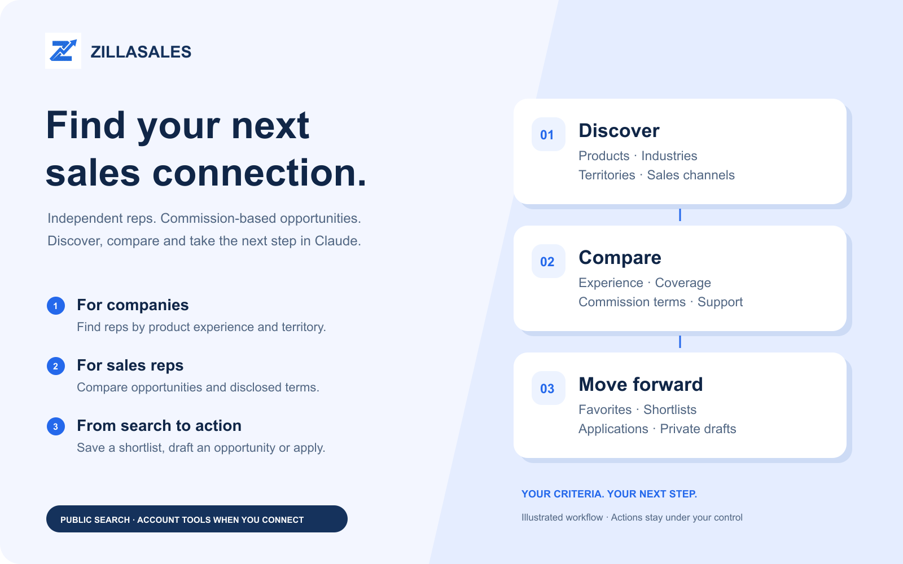

# ZillaSales: Sales Reps & Opportunities


Find independent sales reps and commission-based opportunities. Compare the fit, build a shortlist and take the next step in Claude.



## What you can do

| Your goal | What you can do |
| --- | --- |
| Find independent reps | Search by product experience, industry, territory, buyer type and sales channel. |
| Find opportunities | Discover commission-based sales opportunities and compare disclosed terms, coverage and support. |
| Compare your options | Explore interactive comparison views where supported, with text results also available. |
| Build a shortlist | Connect to save selected reps or opportunities and revisit your favorites. |
| Apply with confidence | Prepare an application, review exactly what will be shared, confirm submission and track your applications. |
| Build sales coverage | Create and edit private opportunity drafts, confirm submission for review, and review your company’s applicants. |

## Try it in Claude

- “Find independent reps for commercial LED lighting in Texas and compare their relevant experience.”
- “Find commission-based industrial automation opportunities covering Texas. Compare territory, commission terms and support.”
- “Save these opportunities to my favorites.”
- “Help me draft an opportunity for our new product line. Ask me for the missing details.”

Public search works without sign-in. Connect your company or rep account for saved items and private workflows. You review and confirm applications and moderation submissions. Saving does not contact anyone, unlock contact details or spend credits. The visual above illustrates the workflow, not live listings or an in-app screenshot.

## Real Claude examples


## Connect

Add this remote MCP URL as a custom web connector in Claude:

```text
https://zillasales.com/api/mcp/claude
```

Choose automatic OAuth client registration (DCR) and sign in when needed. Public tools do not require an account. The server supports S256 PKCE and refresh-token rotation. No API key belongs in this package or in chat.

For Claude Code, add the same endpoint with:

```sh
claude mcp add --transport http zillasales https://zillasales.com/api/mcp/claude
```

For a local checkout of this plugin package, run `claude --plugin-dir /absolute/path/to/plugin`. The plugin is published in the Claude directory. Updates appear after Anthropic publishes the new version.

## Data and privacy

The skills invoke only the declared ZillaSales MCP server. The package runs no local scripts, hooks, installers or background processes. The hosted service receives tool arguments and, after OAuth consent, the account permissions needed for the requested action. It does not require the full conversation. Searches and profile/application content are processed by ZillaSales. Account records remain subject to the service retention and deletion policy. See the [privacy policy](https://zillasales.com/privacy#connected-assistants), [terms](https://zillasales.com/terms) and [developer documentation](https://zillasales.com/developers) for details.

## Support

Use [ZillaSales support](https://zillasales.com/developers#support). If authorization expires or is revoked, reconnect through Claude. If a tool reports a rate limit, wait for its retry interval. Never infer missing results from a failed request.

## License

The plugin package is MIT licensed. Hosted services and their data remain subject to their own terms.

## Install from a local marketplace

```text
/plugin marketplace add /absolute/path/to/zillasales
/plugin install zillasales@zillasales-claude
```

The plugin files are MIT licensed. The remote service uses its own terms and privacy policy linked above. New directory versions are subject to Anthropic review.
